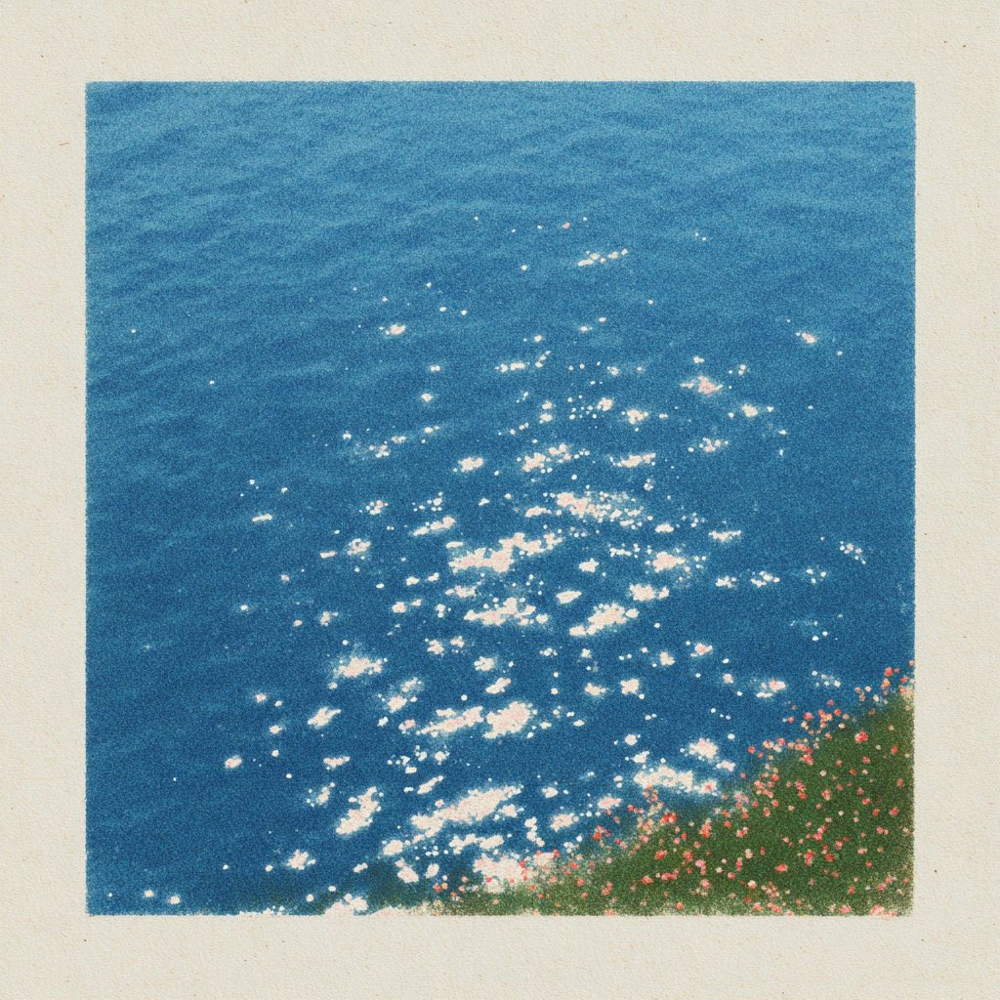
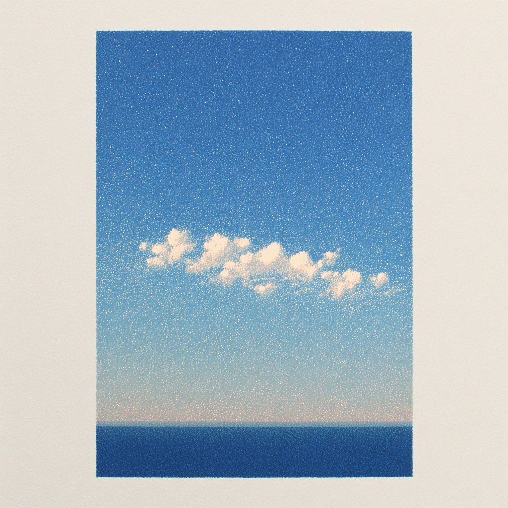
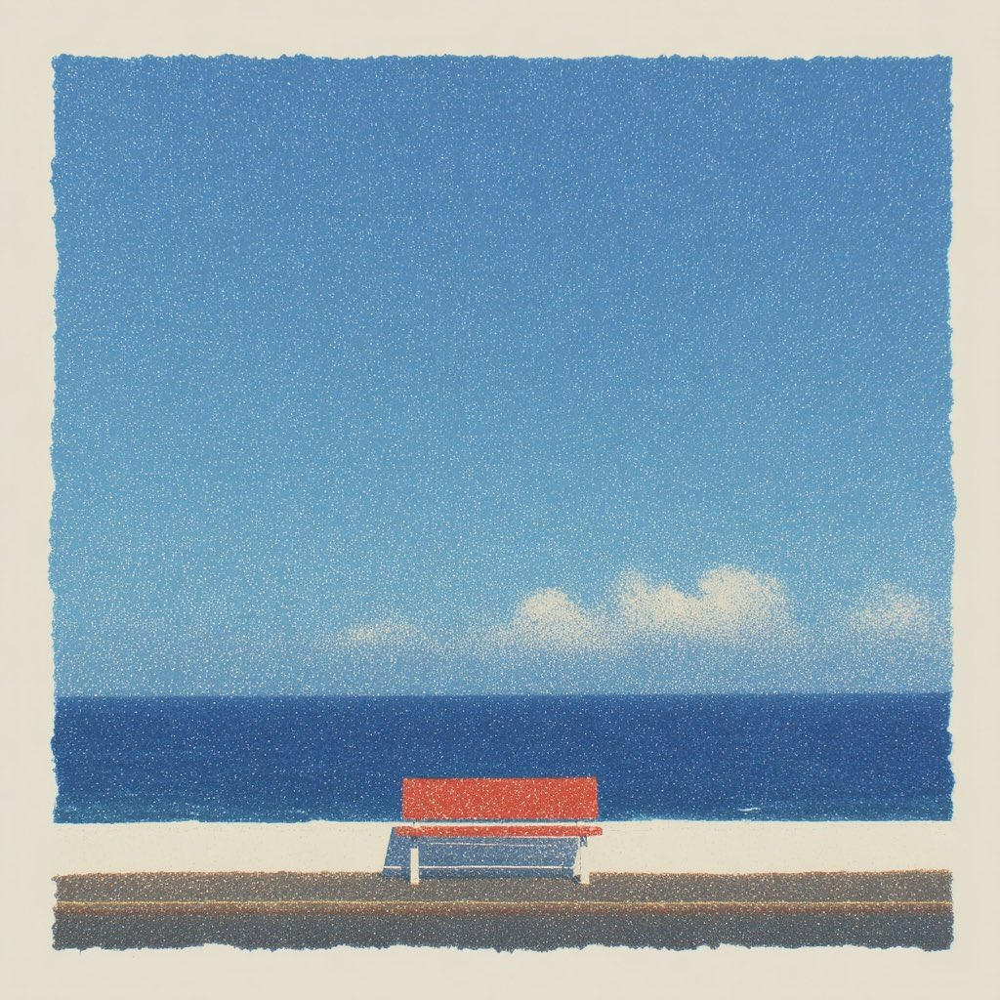
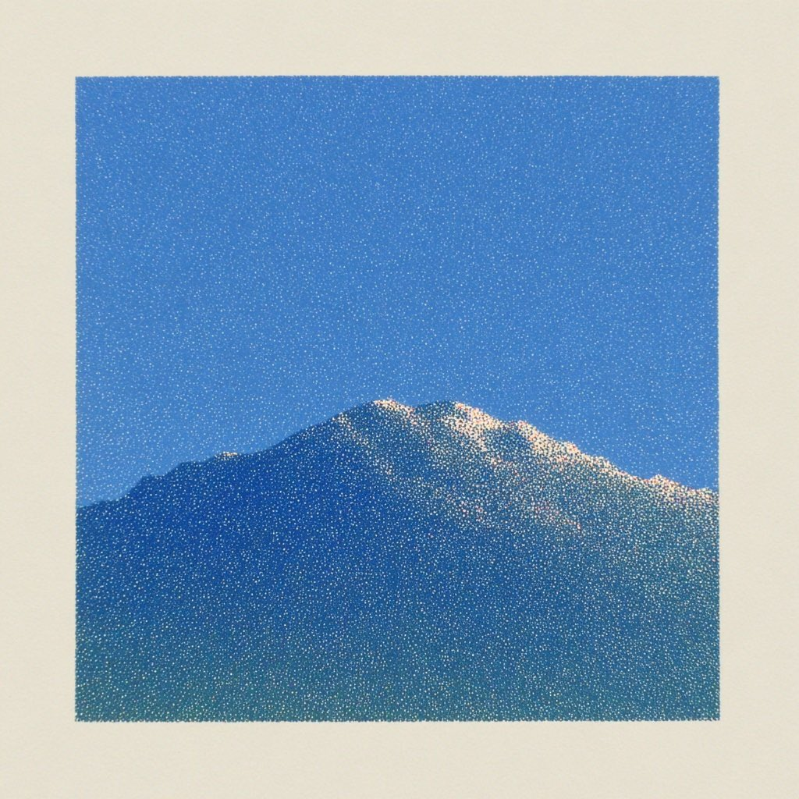
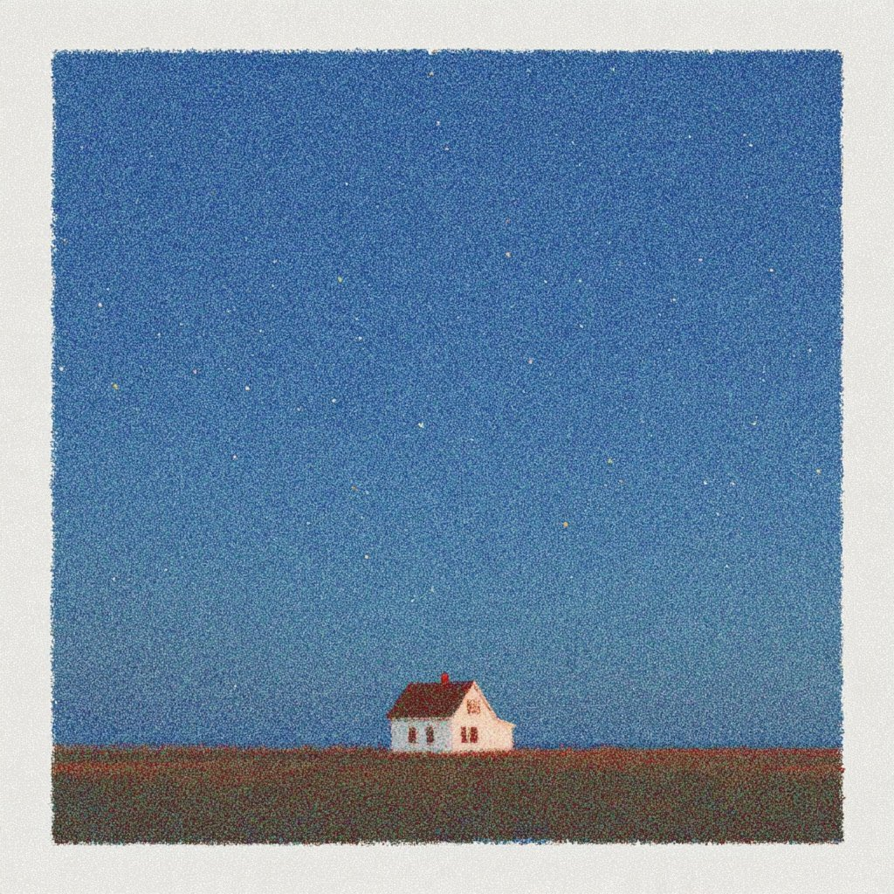

# 自适应颗粒纸印 · Photo Grain Print

把上传的照片逐张转换为干净、细密的颗粒纸印风格，保留主体和构图，并根据原照片选择配色。

## 一句话让 AI 安装

将下面这句话复制给支持安装 Agent Skills、能访问 GitHub 的 AI 助手：

> 请从 https://github.com/1056653564/photo-grain-print 安装 photo-grain-print 技能，完整保留 references 中的五张参考图和配套说明；若已安装同名技能，请先检查，不要直接覆盖。

## 一条命令安装

在已安装 Node.js 的终端运行，使用 Skills CLI 全局安装到支持的 AI 代理：

```sh
npx skills add 1056653564/photo-grain-print -g -y
```

已有同名技能时先检查或备份，再执行安装命令。

也可以下载本仓库 ZIP，将完整目录放到目标应用的技能目录中，并命名为 `photo-grain-print`。Codex 的默认目录为 `~/.codex/skills/photo-grain-print`；其他应用遵循其技能目录约定。

## 使用

上传照片，然后输入：

> 使用 $photo-grain-print，将这些照片分别生成颗粒纸印风格，配色接近参考时匹配参考，差异明显时保留原色，确保画面舒服干净。

可追加“无边框”“颗粒轻一点”等具体要求。默认每张照片生成一张独立图片，并加入浅米色纸边，不覆盖原照片。

## 风格规则

- **色调接近参考**：采用协调的蓝色、奶油白和少量暖色关系。
- **色调差异明显**：保留原照片的主色、冷暖和颜色占比，只迁移颗粒、纸感及高光质感。
- **原图有强反光**：按第一张参考表现为不规则、断续的暖白碎光；颜色随原光源协调。
- **原图没有高光**：不添加闪光；云、白毛、衣服和墙壁等漫反射亮部保持连续。
- 保留主体身份、姿态、关键花纹和构图，颗粒不能造成脏乱或掩盖细节。

## 参考

这些图片定义风格，不是待处理照片。不得将参考中的海、山、房子等内容移植到目标照片。

| 高光与颗粒 | 云与渐变 | 形体与配色 |
| --- | --- | --- |
|  |  |  |

| 山体与暗部 | 深色与暖色关系 |
| --- | --- |
|  |  |

参考图片由用户提供；本仓库不主张其著作权，也不对这些图片授予额外的再许可。

## 运行要求与限制

这是指导 AI 工作的技能，不是独立滤镜程序。默认流程使用 Codex 内置图像生成功能；其他 AI 环境需要等效的多图参考编辑能力，并按实际工具接口执行。只有文本能力的助手可整理提示词，不能仅靠安装技能生成图像。

生成式风格迁移不保证逐像素几何或文字完全一致。生成后应检查主体、关键图案、色彩、画幅与高光。参考图保存在仓库内，不依赖作者电脑上的路径。

## 文件

- `SKILL.md`：技能入口与完整规则。
- `agents/openai.yaml`：Codex 显示名称与调用示例。
- `references/style-guide.md`：五图用途、配色策略和验收情形。
- `references/edit-prompt.md`：单张编辑提示词模板。
- `references/*.jpg`：五张风格参考。
